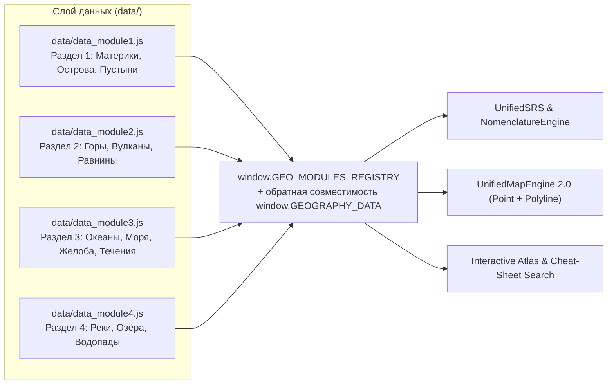
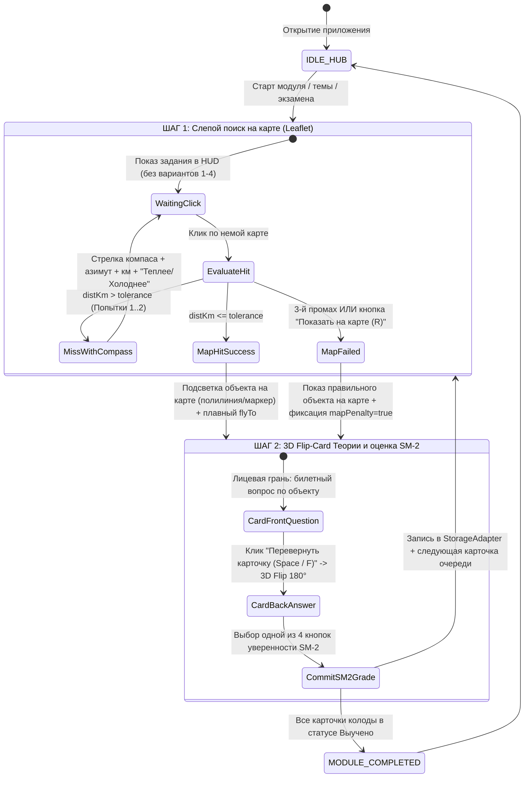
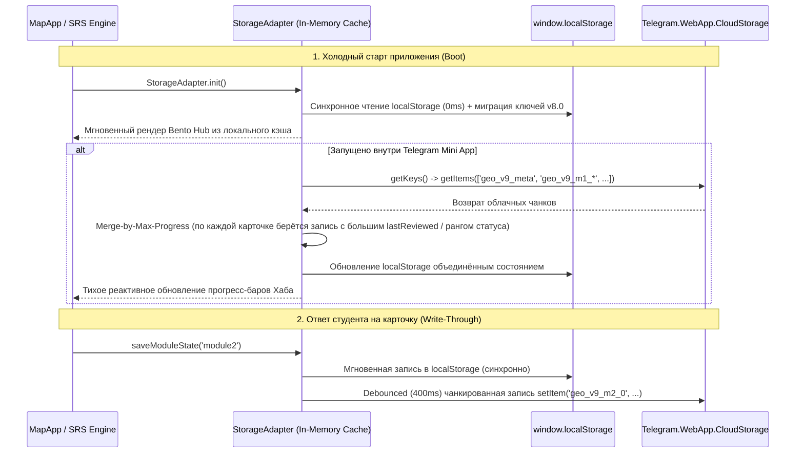

# TASK_BLUEPRINT.md — Технический Архитектурный Блюпринт «ГеоАтлас v9.0 (BSU Semester Hub)»

> **Роль**: Lead Software Architect & Spatial Data Engineer  
> **Проект**: «ГеоАтлас» — 4-модульный интерактивный тренажёр по курсу «Общее Землеведение» (БГУ)  
> **Целевые платформы**: Telegram Mini App (`bsu_bot` экосистема на GitHub Pages), Web Browser (Desktop/Mobile), macOS App (`ГеоАтлас.app`)  
> **UI/UX Стек**: daisyUI Semantic System + Kokonut UI (Glow Cards, Shine Buttons, Bento Grid) + Apple Liquid Glass + Motion Springs + Leaflet Canvas/SVG Engine

---

## 1. Аудит существующей кодовой базы (Baseline v8.0)

По результатам ревизии текущих файлов репозитория (`index.html`, `app.js`, `data.js`, `style.css`) зафиксировано:

1. **[`data.js`](file:///Users/mike/Desktop/%D0%9D%D0%BE%D0%BC%D0%B5%D0%BD%D0%BA%D0%BB%D0%B0%D1%82%D1%83%D1%80%D0%B0%20%D1%82%D1%80%D0%B5%D0%BD%D0%B0%D0%B6%D0%B5%D1%80/data.js) (6 796 строк)**:
   - Экспортирует монолитный объект `window.GEOGRAPHY_DATA` для **Модуля 1**: `earth_metrics`, `continents` (6 материков с площадями, 21 крайним мысом, вершинами, впадинами и средними высотами по Л.П. Шубаеву), `peninsulas` (60), `islands` (148: материковые, вулканические, коралловые), `deserts` (38), `special_entities` (Меланезия, Микронезия, Полинезия, Бермудский треугольник), `desert_types_glossary` (6 типов), `all_map_items` (267 объектов).
2. **[`app.js`](file:///Users/mike/Desktop/%D0%9D%D0%BE%D0%BC%D0%B5%D0%BD%D0%BA%D0%BB%D0%B0%D1%82%D1%83%D1%80%D0%B0%20%D1%82%D1%80%D0%B5%D0%BD%D0%B0%D0%B6%D0%B5%D1%80/app.js) (4 963 строки, модульный IIFE)**:
   - `MotionFX` и `AudioEngine` — готовы к расширению под `Telegram.WebApp.HapticFeedback`.
   - `SPATIAL_EXTENTS` и `GeoMath` — поддерживают точечные координаты и прямоугольные `bounds` с переходом через ±180° меридиан, но **пока не поддерживают линейные геометрии (`polyline`) и расчёт Cross-Track Distance** для рек, течений и желобов.
   - `UnifiedMapEngine` — рендерит немую подложку `clean_atlas` (Carto Voyager NoLabels), физическую карту ESRI, спутник и векторный офлайн-слой; рисует точечные маркеры и `bounds`, но **не имеет векторного рендерера полилиний с направлением течения/стока**.
   - `NomenclatureEngine` и `ContinentExamEngine` — используют упрощённый счётчик шагов (`recordSuccess` / `recordError` / `recordMastered`) и смешанные тестовые чипы 1–4 вместо единого 2-ступенчатого цикла **Слепой клик на карте ➔ 3D Flip-Card с 4 кнопками SM-2**.
   - `Gamification` — содержит дневную цель и звания («Практикант»..«Гранд-Академик»), которые по результатам `/grill-me` необходимо **убрать**, оставив чистый индикатор серии правильных ответов подряд (`🔥 Серия`).
3. **[`index.html`](file:///Users/mike/Desktop/%D0%9D%D0%BE%D0%BC%D0%B5%D0%BD%D0%BA%D0%BB%D0%B0%D1%82%D1%83%D1%80%D0%B0%20%D1%82%D1%80%D0%B5%D0%BD%D0%B0%D0%B6%D0%B5%D1%80/index.html) (782 строки) & [`style.css`](file:///Users/mike/Desktop/%D0%9D%D0%BE%D0%BC%D0%B5%D0%BD%D0%BA%D0%BB%D0%B0%D1%82%D1%83%D1%80%D0%B0%20%D1%82%D1%80%D0%B5%D0%BD%D0%B0%D0%B6%D0%B5%D1%80/style.css) (3 084 строки)**:
   - Стартовый экран `hub-sections-grid` жёстко свёрстан под 2 карточки одного модуля («Устный билет материков» и «267 объектов»), отсутствует сетка **4 семестровых модулей БГУ** и универсальный 3D Anki Flip-Card док для теоретического опроса после клика по карте.

---

## 2. Декомпозиция данных: Модульная архитектура `data/data_module1..4.js`

Вместо единого гигантского `data.js` вводится модульный реестр `window.GEO_MODULES_REGISTRY`, наполняемый четырьмя независимыми скриптами без необходимости в сборщиках (Zero-Build Static Serverless для GitHub Pages):



### 2.1. Состав каждого модуля (строго по загруженным PDF программы БГУ)

| Файл модуля | Раздел курса «Общее Землеведение» | Подразделы (Колоды / Темы) | Объём и специфические атрибуты из PDF |
| :--- | :--- | :--- | :--- |
| **`data/data_module1.js`** | **Раздел 1.** Общие сведения о материках; острова и полуострова; пустыни | 1. Метрики Земли и 6 материков (площади, средние высоты по Шубаеву, крайние мысы, вершины, впадины)<br>2. Мысы материков (21)<br>3. Полуострова (60)<br>4. Острова: материковые (82), вулканические (50), коралловые (16)<br>5. Пустыни мира (38) + 6 типов пустынь, Океания и Бермуды | **~285 объектов и билетных карточек**.<br>Атрибуты: площадь материка (с о-вами / без о-вов), средняя высота (Шубаев/Рябчиков), генезис острова, тип грунта пустыни. |
| **`data/data_module2.js`** | **Раздел 2.** Горы и нагорья; вулканы; равнины | 1. Горы древних платформ (докембрий) — 12 объектов<br>2. Байкальская складчатость — 7 объектов<br>3. Каледонская складчатость — 10 объектов<br>4. Герцинская складчатость — 29 объектов (вкл. 9 гор Центр. Европы)<br>5. Киммерийская (мезозойская) складчатость — 18 объектов<br>6. Альпийская складчатость — 32 объекта<br>7. Вулканы по 4 поясам (Тихоокеанский — 28, Восточно-Африканский — 7, Атлантический — 4, Средиземноморский — 13)<br>8. Равнины: Депрессии суши (16), Низменности (37), Возвышенности (24), Плоскогорья (7), Плато (10) | **~228 объектов**.<br>Атрибуты гор: `orogeny` (эпоха складчатости), `peakName` (высшая точка), `heightM` (высота в м), `locationDesc`.<br>Атрибуты вулканов: `volcanicBelt` (пояс), `heightM`, `coordsText`.<br>Атрибуты депрессий: `depthM` (отметка ниже ур. м. от `-430 м` до `-16 м`). |
| **`data/data_module3.js`** | **Раздел 3.** Океаны, моря, заливы, проливы; глубоководные желоба; океанические течения | 1. Океаны (4 и 5 океанов по Рылюку/Еловичевой + границы океанов)<br>2. Моря по бассейнам: Тихий (20), Атлантический (18), Индийский (8), Северный Ледовитый (11)<br>3. Проливы: Тихий (14), Атлантический (20), Индийский (4), СЛО (9)<br>4. Заливы: Тихий (18), Атлантический (28), Индийский (11), СЛО (7) + Кара-Богаз-Гол<br>5. Глубоководные желоба: Атлантический (5), Индийский (5), Тихий (24), СЛО (1 — ущелье Литке)<br>6. Океанические течения: Тихий (14), Атлантический (16), Индийский (9), СЛО (5) | **~215 объектов**.<br>Атрибуты морей: `oceanBasin`, `areaThousandKm2`, `maxDepthM`.<br>Атрибуты проливов: `lengthKm`, `minWidthKm`.<br>Атрибуты желобов: `maxDepthM`, `lengthKm`, `meanWidthKm`, `coordsMaxDepth`.<br>Атрибуты течений: `tempGrade` (`Т` — тёплое, `Х` — холодное, `Н` — нейтральное), `genesis` (`Д` — дрейфовое, `К` — компенсационное, `С` — сточное), `velocityCmS` (см/с). |
| **`data/data_module4.js`** | **Раздел 4.** Реки, озёра, водопады | 1. Реки Евразии (76 рек и главных притоков)<br>2. Реки Африки (15), Северной Америки (18), Южной Америки (21), Австралии (4)<br>3. Мировые рекорды рек (топ-3 по длине, площади бассейна, объёму стока)<br>4. Водопады мира (19 + топ-3 самых высоких, самый широкий Кхон, самый мощный Игуасу)<br>5. Озёра по материкам: Евразия (37), Африка (12), Сев. Америка (14), Юж. Америка (5), Австралия (3) + гидрологические рекорды | **~225 объектов**.<br>Атрибуты рек: `parentRiver` / `tributaries`, `source`, `mouth`, `lengthKm`, `basinArea`, `runoff`.<br>Атрибуты водопадов: `dropHeightM`, `riverName`, `recordNote`.<br>Атрибуты озёр: `continent`, `maxDepthM`, `areaKm2`, `salinityType`, `recordFact`. |

### 2.2. Подключение в `index.html` и обратная совместимость

В `index.html` вместо `<script src="data.js"></script>` подключаются:
```html
<script src="data/data_module1.js"></script>
<script src="data/data_module2.js"></script>
<script src="data/data_module3.js"></script>
<script src="data/data_module4.js"></script>
<script src="app.js"></script>
```
При этом `data/data_module1.js` инициализирует `window.GEO_MODULES_REGISTRY = { module1, module2, module3, module4 }` и одновременно сохраняет алиас `window.GEOGRAPHY_DATA = window.GEO_MODULES_REGISTRY.module1.legacyData`, благодаря чему существующий код Модуля 1 продолжает работать без единой регрессии.

---

## 3. Единая схема объекта номенклатуры (`UnifiedGeoItemSchema`)

Каждый объект во всех 4 модулях приводится к строго типизированному интерфейсу, поддерживающему как **точечные/площадные (`point`)**, так и **линейные (`polyline`)** геометрии:

```javascript
/**
 * Единая схема объекта номенклатуры ГеоАтлас v9.0
 */
const UnifiedGeoItemSchema = {
  // 1. Идентификация и иерархия
  id: "m2_mtn_ural",                  // Глобально уникальный ID с префиксом модуля (m1_*, m2_*, m3_*, m4_*)
  moduleId: "module2",                // 'module1' | 'module2' | 'module3' | 'module4'
  submoduleId: "m2_hercynian",        // ID подраздела/колоды внутри модуля
  category: "mountains",              // Внутренний класс ('mountains', 'volcanoes', 'plains', 'seas', 'straits', 'gulfs', 'trenches', 'currents', 'rivers', 'waterfalls', 'lakes', ...)
  categoryRu: "Горы (герцинская скл.)", // Человекочитаемый бейдж для HUD и конспекта
  difficulty: "Базовый",              // 'Базовый' | 'Стандартный' | 'Хардкор' (для фильтрации по уровням сложности)

  // 2. Отображаемые названия и задание для Шага 1 (Карта)
  name: "Уральские горы",             // Каноническое название из программы БГУ
  aliases: ["Урал"],                  // Синонимы для полнотекстового поиска в шпаргалке
  region: "Евразия",                  // Материк или океанический бассейн
  locationDesc: "Между Восточно-Европейской и Западно-Сибирской равнинами",
  mapPrompt: "Покажите на карте: Уральские горы", // Вопрос Шага 1 на слепой карте

  // 3. Пространственная геометрия и адаптивные допуски (Hitbox)
  geometryType: "polyline",           // 'point' | 'polyline'
  lat: 60.0,                          // Якорная широта (центроид для подлёта камеры и стрелки компаса)
  lng: 59.5,                          // Якорная долгота
  
  // Для geometryType === 'point':
  hitRadiusKm: 280,                   // Адаптивный радиус попадания (70–120 км для вершин/вулканов/водопадов/проливов; 220–500 км для равнин/морей/горных систем)
  bounds: [51.0, 57.0, 68.5, 66.0],   // Опциональный BBox [minLat, minLng, maxLat, maxLng] (с поддержкой ±180°)

  // Для geometryType === 'polyline' (реки, морские течения, желоба, протяжённые хребты):
  coords: [                           // Упорядоченный массив вершин полилинии [[lat, lng], ...] (или массив ветвей для рек с истоками)
    [68.5, 66.0], [65.0, 60.5], [60.0, 59.0], [55.5, 59.5], [51.2, 58.5]
  ],
  crossTrackBufferKm: 130,            // Допустимое ортогональное отклонение клика от оси полилинии (100–150 км)
  flowStyle: {                        // Только для рек и морских течений:
    hasDirection: false,              // true для течений и рек (рисуются векторные стрелки вдоль линии)
    tempType: null                    // 'warm' (#f43f5e) | 'cold' (#38bdf8) | 'neutral' (#a855f7) | 'river' (#0ea5e9) | 'trench' (#6366f1)
  },

  // 4. Шаг 2: Теоретическая карточка Anki (3D Flip-Card без вариантов выбора)
  ankiCard: {
    hasTheoryStep: true,              // Открывать ли Шаг 2 после нахождения на карте
    frontQuestion: "Укажите эпоху складчатости, высшую точку и абсолютную высоту Уральских гор:",
    backMainAnswer: "Герцинская складчатость • г. Народная (1895 м)",
    backMetrics: [
      { label: "Складчатость", value: "Герцинская (палеозой)" },
      { label: "Высшая точка", value: "г. Народная" },
      { label: "Высота", value: "1895 м" },
      { label: "Положение", value: "Между Восточно-Европейской и Западно-Сибирской равнинами" }
    ],
    backNote: "Южным продолжением Урала являются горы Мугоджары (г. Большой Боктыбай, 657 м)."
  }
};
```

### 3.1. Шкала адаптивных геодезических допусков (Анти-Пиксель-Хантинг)

Чтобы исключить фрустрацию при ответе с телефона или тачпада и при этом сохранить академическую точность:

| Категория объекта | Тип геометрии | Базовый допуск (`hitRadiusKm` / `crossTrackBufferKm`) | Масштабирование от зума (`zoomFactor`) |
| :--- | :--- | :--- | :--- |
| **Вулканы, вершины, водопады, депрессии, мысы, узкие проливы** | `point` | **90–140 км** (на обзорном зуме мира `z=2.5` автоматически расширяется до `180 км`) | `max(hitRadiusKm, screenPxRadiusInKm(22px))` |
| **Острова, заливы, озёра, малые возвышенности** | `point` + `bounds` | **150–260 км** + весь контур `bounds` | Полное попадание внутри `bounds` + буфер `110 км` от границы |
| **Крупные равнины, низменности, плоскогорья, моря, пустыни** | `point` + `bounds` | **300–500 км** + весь контур `bounds` | Любой клик внутри области объекта засчитывается с `distKm = 0` |
| **Реки, океанические течения, глубоководные желоба, хребты** | `polyline` | **110–150 км** (`crossTrackBufferKm` вдоль всей длины полилинии) | Клик в любой точке русла реки или стрелки течения в радиусе `110–150 км` от любого сегмента засчитывается! |

### 3.2. Математический алгоритм `GeoMath.calcPolylineDistanceKm(clickLat, clickLng, polylineCoords)`

Для линейных объектов в `GeoMath` добавляется функция расчёта кратчайшего расстояния от точки клика $P(\varphi_p, \lambda_p)$ до ломаной линии $A_1 A_2 \dots A_n$:
1. Для каждого сегмента $[A_i, A_{i+1}]$ координаты переводятся в локальную эквидистантную проекцию относительно среднего меридиана сегмента (с нормализацией $\Delta\lambda$ через `normalizeLng` для корректного пересечения $\pm 180^\circ$ — например, Алеутский желоб или течение Западных ветров).
2. Вычисляется параметр проекции $t = \text{clamp}\left(\frac{\vec{A_i P} \cdot \vec{A_i A_{i+1}}}{\|\vec{A_i A_{i+1}}\|^2}, 0, 1\right)$.
3. Находится ближайшая точка на сегменте $C_i = A_i + t(A_{i+1} - A_i)$ и сферическое расстояние Гаверсинуса $d_i = \text{calcDistanceKm}(P, C_i)$.
4. Возвращается $\min_i d_i$ и координаты ближайшей точки $C_{\min}$ (именно к $C_{\min}$ рисуется пунктирная линия промаха и считается азимут компаса!).

---

## 4. Конечный автомат 2-Step Anki Loop (`TwoStepAnkiFSM`)

Весь процесс тренировки во всех 4 модулях управляется единым детерминированным конечным автоматом (FSM):



### 4.1. Детализация Шага 1: Слепой клик и Динамический компас
- На карте **всегда** используется немая контурная/физическая подложка без географических подписей (`clean_atlas`, `esri_phys`, `vector_offline`).
- Никаких вариантов выбора `1–4` на карте не выводится — студент работает как у доски с указкой.
- При промахе:
  1. На месте клика ставится пин попытки `#1` / `#2` с цветовой индикацией температуры (`#f59e0b` если $<900\text{ км}$, `#f43f5e` если дальше) и кратковременным анимированным вектором-стрелкой в сторону цели.
  2. В баннере обратной связи HUD отображается:
     - Динамический статус: `🔥 Теплее!` / `❄️ Холоднее!`
     - Точная дистанция до ближайшей границы/сегмента объекта: `~1 240 км`
     - Направление по 8 румбам со стрелкой: `к северо-востоку ↗`
  3. Срабатывает тактильный отклик `HapticFeedback.notificationOccurred('warning')`.

### 4.2. Детализация Шага 2: 3D Flip-Card и Матрица интервалов SM-2
После локализации объекта на карте:
- Если у объекта `ankiCard.hasTheoryStep === true` (или включён стандартный режим «Полный коллоквиум: Карта + Теория»), поверх нижней/центральной части экрана плавно появляется **3D Flip-Card** (построенная на CSS Grid `grid-template-areas: "card"` с `backface-visibility: hidden`, чтобы обе грани автоматически адаптировались по высоте без обрезки текста).
- **Лицевая сторона (Front)**:
  - Показывает название найденного на карте объекта и билетный вопрос (например: *«Вулкан Ключевская Сопка найден! Вспомните: вулканический пояс и абсолютную высоту в метрах»*).
  - Кнопка **«Показать эталонный ответ ↻ (Пробел / Enter)»**.
- **Оборотная сторона (Back)**:
  - Показывает эталонный ответ из таблиц БГУ, структурированные плашки метрик и **4 кнопки самооценки Anki SM-2**:

| Кнопка (Хоткей) | Название в UI | Цвет (daisyUI / Токен) | Логика перехода состояния и интервала (`SM-2`) | Ограничение при провале карты (`mapFailed === true`) |
| :--- | :--- | :--- | :--- | :--- |
| **`1`** | **«Не выучено»** *(Снова)* | `--rose` (`#f43f5e`) | `status = 'learning'`, `reps = 0`, `lapses++`, `ease = max(1.3, ease - 0.20)`, возврат через **2 карточки** (`intervalHours = 0.1`) | Доступна и подсвечена как рекомендуемая |
| **`2`** | **«Трудно»** | `--amber` (`#f59e0b`) | `status = 'learning'` (или остаётся в `review`), `reps = max(1, reps)`, `ease = max(1.3, ease - 0.15)`, возврат через **5 карточек** (`intervalHours = 2`) | Доступна (если теорию знал отлично, но на карте нашёл со 2–3 попытки) |
| **`3`** | **«Хорошо»** | `--sky` (`#38bdf8`) | `new -> learning (step +6)` или `learning -> review (step +15)` или `review -> mastered (при reps >= 2, step +45)`, `intervalHours *= ease` | Блокируется/предупреждает, если на карте было 3 промаха (`mapFailed`) |
| **`4`** | **«Выучено»** | `--emerald` (`#10b981`) | Мгновенный перевод в `status = 'mastered'`, `reps = max(reps + 1, 3)`, `ease = min(3.0, ease + 0.15)`, `stepGap = 75`, `intervalHours = 96` | Активна только при нахождении объекта на карте без раскрытия ответа |

> **Режим для объектов без отдельного теоретического вопроса** (например, рядовой полуостров или низменность, где требуется только показать объект на карте и знать его регион): после клика на карте сразу открывается компактная панель оценки SM-2 с краткой справкой об объекте (либо при чистом попадании с 1-й попытки доступно быстрое подтверждение клавишей `Space/Enter` = «Хорошо» или выбор `1–4`).

---

## 5. Архитектура адаптера хранилища (`StorageAdapter`: Telegram CloudStorage + `localStorage`)

### 5.1. Ограничения Telegram CloudStorage и стратегия шардирования
`Telegram.WebApp.CloudStorage` предоставляет бесплатно до **1 024 ключей на пользователя**, но размер значения одного ключа ограничен **4 096 символами (4 КБ)**.
Поскольку во всех 4 модулях суммарно ~950 объектов, сохранение полного JSON типа `{ "m2_mtn_ural": { status: "review", reps: 2, lapses: 0, dueStep: 42, lastReviewed: 1731420000000, ease: 2.5 } }` в один ключ превысит 4 КБ.

**Инженерное решение — Компактная кортежная сериализация + Шардирование по модулям**:
1. В памяти приложения (`MemoryState`) карточка хранится как удобный JS-объект.
2. При сериализации для облака каждое состояние карточки кодируется компактным массивом из 5 чисел:
   ```
   "ural": [stCode, reps, lapses, dueStep, lastRevMin]
   ```
   где `stCode`: `0 = new` (новые карточки вообще не пишутся в облако — экономия до 70% места!), `1 = learning`, `2 = review`, `3 = mastered`; `lastRevMin = Math.floor(timestamp / 60000)`.
   Одна запись занимает всего **~24 байта**! Даже 250 активных объектов модуля занимают `~5.5 КБ`, которые автоматически разбиваются на чанки по `3 500 символов`:
   - `geo_v9_m1_0`, `geo_v9_m1_1` (Модуль 1)
   - `geo_v9_m2_0`, `geo_v9_m2_1` (Модуль 2)
   - `geo_v9_m3_0`, `geo_v9_m3_1` (Модуль 3)
   - `geo_v9_m4_0`, `geo_v9_m4_1` (Модуль 4)
   - `geo_v9_meta` (общие метаданные: `updatedAt`, `activeModuleId`, `activeDeckId`, `sessionStreak`, `bestStreak`, `bestBlitzScore`, `soundMuted`).

### 5.2. Диаграмма синхронизации и разрешения конфликтов



---

## 6. UI/UX Архитектура Главного Хаба и Справочника

### 6.1. Главный экран (4-Module Bento Hub)
- **Шапка Хаба (`hub-header`)**:
  - Логотип и название «ГеоАтлас • Общее Землеведение БГУ».
  - Бейдж синхронизации: `☁️ Telegram Sync` (если открыто в ТГ) или `💾 Локальный режим`.
  - Счётчик текущей ударной серии правильных ответов с первой попытки: `🔥 Серия: 7 (рек. 24)` — **без** дневных лимитов и **без** искусственных званий/рангов.
  - Кнопки: `📚 Интерактивная шпаргалка`, `⚡ Блиц 60 сек`, `⚙️ Прогресс / Бэкап`, `🔔 Звук`.
- **Сетка 4 Семестровых Модулей (`hub-modules-bento-grid` — 2×2 на десктопе, 1 колонка на мобильном)**:
  - **Карточка Модуля 1**: «1. Материки, острова, полуострова, пустыни» (индикатор Anki SRS `Новые / Повтор / Закреп. / Выучено`, прогресс-бар %, быстрые чипы подразделов + кнопки `▶ Учить весь Раздел 1` и `📦 Выбрать тему`).
  - **Карточка Модуля 2**: «2. Горы и нагорья, вулканы, равнины» (быстрые чипы: *6 эпох складчатости*, *4 пояса вулканов*, *Депрессии и равнины* + кнопки `▶ Учить весь Раздел 2` и `📦 Выбрать тему`).
  - **Карточка Модуля 3**: «3. Океаны, моря, проливы, заливы, желоба, течения» (быстрые чипы: *Океаны и моря*, *Проливы и заливы*, *Желоба*, *Течения* + кнопки `▶ Учить весь Раздел 3` и `📦 Выбрать тему`).
  - **Карточка Модуля 4**: «4. Реки, озёра, водопады» (быстрые чипы: *Реки по материкам*, *Водопады и рекорды*, *Озёра мира* + кнопки `▶ Учить весь Раздел 4` и `📦 Выбрать тему`).
- **Нижняя панель генерального опроса**:
  - Переключатель фильтра сложности: `🟢 Базовый минимум` | `🟡 Полная программа БГУ (Стандарт)` | `🔴 Хардкор (Все объекты + метрики)`.
  - Кнопка `🎓 Генеральный экзамен по всем 4 разделам семестра`.

### 6.2. Интерактивная Шпаргалка-Атлас (`Theory & Reference Modal v9.0`)
- Переключатель 4 разделов + строка живого мгновенного поиска по названию, складчатости, высшей точке, глубине, истоку или океану.
- Структурированные таблицы точно по PDF-файлам кафедры.
- **Живой переход на карту**: в каждой строке таблицы (гора, вулкан, равнина, море, пролив, желоб, течение, река, озеро, водопад) есть кнопка `🎯 На карте`, которая закрывает шпаргалку, включает режим Атласа, плавно наводит камеру (`flyTo`) на объект, отрисовывает его полилинию/маркер и открывает карточку-инспектор со всеми характеристиками.

---

## 7. Пошаговый план внедрения без поломки Модуля 1 (Implementation Roadmap)

| Фаза | Задача | Изменяемые / создаваемые файлы | Критерий приёмки (Verification) |
| :--- | :--- | :--- | :--- |
| **Фаза 1** | **Инженерия пространственных данных (Modules 1–4)**<br>Выделение `data/data_module1.js` из `data.js` с сохранением обратной совместимости. Оцифровка 100% списков из PDF для `data/data_module2.js` (горы по 6 складчатостям, вулканы по 4 поясам, равнины), `data/data_module3.js` (океаны, моря, проливы, заливы, желоба с координатами, течения с полилиниями), `data/data_module4.js` (реки с полилиниями и притоками, водопады, озёра и рекорды). | `data/data_module1.js`<br>`data/data_module2.js`<br>`data/data_module3.js`<br>`data/data_module4.js` | Все 4 файла загружаются без синтаксических ошибок; `window.GEO_MODULES_REGISTRY` содержит полные списки из PDF; `window.GEOGRAPHY_DATA` остаётся доступным для старого кода. |
| **Фаза 2** | **Адаптер хранилища и Telegram Mini App SDK**<br>Внедрение `StorageAdapter` с поддержкой `Telegram.WebApp.CloudStorage`, чанкированием до 3.5 КБ, `localStorage` fallback и авто-миграцией существующих ключей `geoatlas_nomen_states` / `geoatlas_cont_anki_states` из v8.0. Подключение `Telegram.WebApp.HapticFeedback`. | `index.html`<br>`app.js` (`StorageAdapter`, `HapticEngine`) | Прогресс Модуля 1 из v8.0 сохраняется на 100%; запись и чтение работают как в стандартном браузере, так и при эмуляции `window.Telegram.WebApp.CloudStorage`. |
| **Фаза 3** | **Геометрическое ядро Leaflet 2.0 (Point + Polyline + Cross-Track Hitbox)**<br>Расширение `GeoMath` алгоритмом `calcPolylineDistanceKm`. Добавление в `UnifiedMapEngine` рендеринга векторных полилиний рек, желобов и стрелок морских течений (тёплые/холодные), а также улучшенного компаса промаха. | `app.js` (`GeoMath`, `UnifiedMapEngine`)<br>`style.css` | Клик вдоль любой части русла реки или стрелки течения в радиусе 110–150 км корректно засчитывается; при промахе показывается точное расстояние до ближайшего сегмента и румб компаса. |
| **Фаза 4** | **Конечный автомат 2-Step Anki Loop & 3D Flip-Card SM-2**<br>Реализация двухступенчатого цикла: Шаг 1 (строгий слепой клик по карте без вариантов 1–4) ➔ Шаг 2 (3D Flip-Card с вопросом на лицевой стороне, переворотом и 4 кнопками SM-2: «Не выучено», «Трудно», «Хорошо», «Выучено»). | `index.html`<br>`style.css`<br>`app.js` (`TwoStepAnkiFSM`, `UnifiedSRSEngine`) | После нахождения объекта на карте открывается 3D-карточка теории без спойлеров; переворот показывает эталон из PDF; нажатие кнопок 1–4 корректно пересчитывает интервал SM-2 и обновляет счётчики. |
| **Фаза 5** | **Редизайн Главного Хаба (4 Bento-модуля) и Интерактивной Шпаргалки**<br>Обновление `hubScreen` под 4 карточки модулей БГУ, модальное окно выбора тем/подразделов каждого модуля, переключатель уровней сложности, удаление званий/дневных целей (остается серия `🔥`). Обновление справочника `theoryModal` с таблицами всех 4 разделов и живым переходом `🎯 На карте`. | `index.html`<br>`style.css`<br>`app.js` (`MapApp`) | Все 4 модуля открываются из Bento Hub как целиком («Весь модуль»), так и по отдельным темам; поиск в шпаргалке находит любой объект из 4 PDF и по клику центрирует на нём карту. |
| **Фаза 6** | **Интеграционное тестирование, сборка macOS `.app` и готовность к GitHub Pages**<br>Автоматический проверочный скрипт целостности координат и полилиний всех 4 модулей, проверка адаптивной вёрстки (Mobile Telegram WebView & Desktop), синхронизация с `ГеоАтлас.app`. | `ГеоАтлас.app`<br>`README.md` | 0 ошибок в консоли, 100% покрытие объектов из 4 PDF, плавная работа на мобильном и десктопном экране. |
